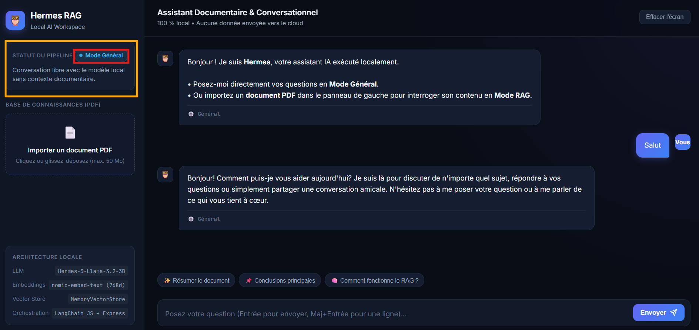
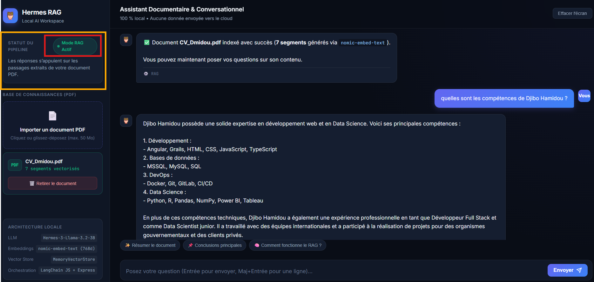

# 🦉 Hermes RAG Studio — Assistant IA Local & Documentaire


Application web full-stack d'assistant conversationnel et documentaire **100 % local-first**. Elle permet d'interagir avec un grand modèle de langage (LLM) ou d'interroger le contenu de documents PDF via une architecture **RAG (Retrieval-Augmented Generation)**, sans qu'aucune donnée ne quitte la machine locale.

---

## ✨ Fonctionnalités principales

* **🔒 Confidentialité totale (Zero-Cloud) :** Exécution intégrale de l'inférence LLM et du calcul d'embeddings en local via LM Studio et Ollama.
* **🔄 Bascule dynamique de pipeline :**
  * **Mode Général :** Conversation libre et directe avec le modèle `Hermes-3-Llama-3.2-3B` lorsqu'aucun document n'est chargé.
  * **Mode RAG Actif :** Indexation automatique à l'import d'un PDF et génération de réponses ancrées dans les passages les plus pertinents du document.
* **📄 Ingestion PDF par glisser-déposer :** Extraction de texte, découpage intelligent en segments (*chunking* avec chevauchement), vectorisation en 768 dimensions et stockage en mémoire vive (`MemoryVectorStore`).
* **🎨 Interface Dark Workspace moderne :** Tableau de bord réactif affichant l'état du pipeline en temps réel, la stack active, les sources citées sous chaque réponse et des suggestions de requêtes rapides.

---

## 🖼️ Aperçu de l'interface

| Mode Général (Conversation libre) | Mode RAG Actif (Interrogation de PDF) |
| :---: | :---: |
|  |  |

---

## 🏗️ Architecture technique

Le système repose sur une séparation claire entre l'interface client, le serveur d'orchestration Node.js et les deux moteurs d'IA locaux :

```text
┌─────────────────────────┐      HTTP / JSON       ┌──────────────────────────────────────────┐
│     Frontend (Web)      │ ◄────────────────────► │        Backend Express (Port 3000)       │
│  HTML5 / CSS3 / JS ES6  │   /upload /chat /reset │            LangChain JS 0.3.x            │
└─────────────────────────┘                        └────────────┬────────────────┬────────────┘
                                                                │                │
                         ┌──────────────────────────────────────┘                └──────────────────────────────────────┐
                         ▼                                                                                              ▼
┌─────────────────────────────────────────────────┐                                            ┌─────────────────────────────────────────────────┐
│           Pipeline d'Ingestion (RAG)            │                                            │             Pipeline de Génération              │
│  1. PDFLoader (extraction du texte brut)        │                                            │  1. Similarity Search (Top-3 chunks)            │
│  2. RecursiveCharacterTextSplitter (512 / 128)  │                                            │  2. Injection du contexte dans le prompt        │
│  3. Ollama Embeddings : nomic-embed-text (768d) │                                            │  3. LM Studio API : hermes-3-llama-3.2-3b       │
│  4. Indexation dans MemoryVectorStore           │                                            │     (http://localhost:1234/v1)                  │
└─────────────────────────────────────────────────┘                                            └─────────────────────────────────────────────────┘
```

### Stack technologique

* **Backend & Orchestration :** Node.js (ES Modules), Express.js, `express-fileupload`, `pdf-parse`, LangChain JS (`@langchain/core`, `@langchain/community`, `@langchain/openai`, `@langchain/textsplitters`).
* **Moteurs d'IA locaux :**
  * **Génération :** [LM Studio](https://lmstudio.ai/) exposant une API compatible OpenAI sur `http://localhost:1234/v1` avec le modèle **`hermes-3-llama-3.2-3b`** (`Q4_K_M`).
  * **Embeddings :** [Ollama](https://ollama.com/) sur `http://localhost:11434` avec le modèle **`nomic-embed-text`** (768 dimensions).
* **Frontend :** HTML5 sémantique, CSS3 (Grid, variables CSS, thème sombre), JavaScript Vanilla (Fetch API, Drag & Drop, rendu Markdown sécurisé).

---

## 📁 Structure du projet

```text
langchain-js-app/
├── backend/
│   ├── app.js              # Serveur Express, routes API et orchestration RAG LangChain
│   ├── package.json        # Dépendances et scripts Node.js
│   └── uploads/            # Stockage temporaire des PDF importés (ignoré par Git)
├── frontend/
│   ├── index.html          # Structure de l'interface (Sidebar technique + Zone de chat)
│   ├── style.css           # Design system Dark Slate et animations
│   └── frontend.js         # Logique client, gestion d'état et appels API
├── docs/
│   └── screenshots/        # Captures d'écran de démonstration
├── .gitignore              # Exclusion de node_modules, .env, uploads/ et vector-stores/
└── README.md
```

---

## 🚀 Installation et démarrage

### 1. Prérequis

* **Node.js** (v18+ recommandé)
* **LM Studio** installé avec le modèle **`hermes-3-llama-3.2-3b`** téléchargé.
* **Ollama** installé avec le modèle d'embeddings **`nomic-embed-text`**.

### 2. Cloner le dépôt et installer les dépendances

```bash
git clone [https://github.com/HamidouDjibo/langchain_js_app.git](https://github.com/HamidouDjibo/langchain_js_app.git)
cd langchain_js_app/backend
npm install
```

### 3. Démarrer les services d'IA locaux

1. **Ollama :** Vérifiez que le service tourne en arrière-plan (`http://localhost:11434`) et téléchargez le modèle d'embeddings si nécessaire :
   ```bash
   ollama pull nomic-embed-text
   ```
2. **LM Studio :** Ouvrez l'onglet **Developer (`>_`)**, chargez **`hermes-3-llama-3.2-3b`** en mémoire et démarrez le serveur local (**Status: Running** sur le port **`1234`**).

### 4. Lancer l'application

Dans le dossier `backend/` :

```bash
npm start
```

Le serveur démarre sur `http://localhost:3000`. Ouvrez ensuite `frontend/index.html` dans votre navigateur (ou via l'extension *Live Server* dans VS Code).

---

## 🔌 Endpoints de l'API

| Méthode | Endpoint | Corps de la requête | Description |
| :--- | :--- | :--- | :--- |
| `POST` | `/upload` | `multipart/form-data` (`pdf`, max. 50 Mo) | Extrait le texte du PDF, génère les vecteurs via Ollama et active le mode RAG. |
| `POST` | `/chat` | `JSON` `{ "question": "..." }` | Interroge le `MemoryVectorStore` (top-3) si un document est actif, sinon répond en mode Général. |
| `POST` | `/reset` | `JSON` `{ "deleteFiles": true }` | Réinitialise l'index vectoriel en mémoire, supprime les PDF temporaires et revient au mode Général. |

---

## 🛣️ Pistes d'amélioration

* Migration des chaînes historiques (`loadQAStuffChain`) vers les chaînes composables **LCEL** (`createStuffDocumentsChain`).
* Persistance des index vectoriels sur disque (`backend/vector-stores/`) et support de l'interrogation multi-documents.
* Ajout d'une mémoire conversationnelle glissante pour conserver le contexte sur plusieurs échanges consécutifs.